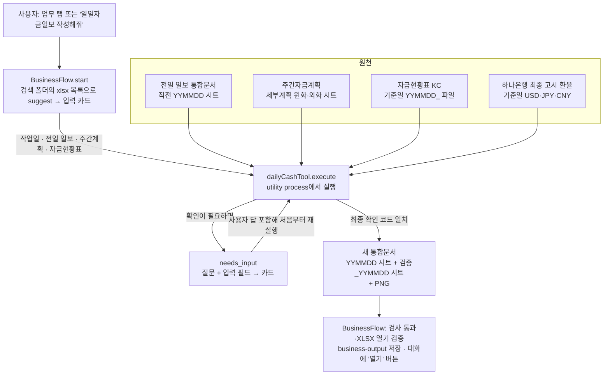

# 일일자금일보(daily_cash) 워크플로 구성

코드 기준으로 "무엇을 읽어 무엇을 채우고, 중간에 무엇을 사용자에게 확인하며, 최종 결과가 어떤 형태인지"를 정리한 문서다. 로직 검토와 수정의 출발점으로 쓴다. 규칙 근거는 [docs/DAILY_CASH.md](../docs/DAILY_CASH.md), 공통 실행 계약은 [docs/BUSINESS_TOOLS.md](../docs/BUSINESS_TOOLS.md)를 따른다.

## 1. 한눈에 보기



핵심 성질

- **오류는 run을 끝내지 않는다.** Tool의 `failed`든 실행 중 예외(worker 종료, 시간 초과, 출력 검증 실패)든, 공통 실행부가 같은 입력 카드를 오류 메시지와 함께 다시 띄운다. 답은 유지되고 사용자가 고쳐서 "다시 실행"하거나 "작업 중단"으로 끝낸다. 원천 파일을 바꿔야 하는 오류(기준일 시트 존재, 7일 넘은 전일 일보, KC 날짜 불일치, 양식 불일치, 총 원화 불일치)는 메시지대로 새 작업을 시작한다.
- Tool은 **상태가 없다.** 사용자가 답할 때마다 원천 파일 3종과 지금까지의 모든 답(`values`)과 `checkpoint`(조회된 환율)를 들고 `execute`를 처음부터 다시 돈다. 그래서 아래 2절의 확인 단계는 "순서대로 통과해야 하는 관문"이고, 앞 관문의 답이 있으면 그냥 지나간다.
- 계산은 전부 코드가 한다(Decimal 30자리). LLM은 "어떤 업무인지" 라우팅에만 쓰인다.
- 원천 파일은 해시로 고정된다. 첫 실행 뒤 파일이나 작업일을 바꾸려면 새 작업을 시작해야 한다.

## 2. 실행 순서와 확인 지점

`electron/business/dailyCash.ts` `execute`의 순서 그대로다. **[확인]** 은 카드로 사용자에게 묻는 지점, **[중단]** 은 실패로 끝나는 지점이다.

| # | 단계 | 읽는 것 | 하는 일 | 사용자 개입 |
|---|------|---------|---------|-------------|
| 0 | 입력 수집 | 검색 폴더의 xlsx 파일명 | `suggest`가 작업일=서울 오늘, 전일 일보(`일일자금일보` 포함·YYMMDD ≤ 기준일 전날·샘플/테스트 제외 최신), 주간계획(`주간자금계획` MMDD ≤ 기준일/작업일, 주 경계면 2개), 자금현황표(`기준일YYMMDD_` 시작)를 미리 채움 | **[확인]** 첫 실행 전에는 날짜·파일 모두 변경 가능 |
| 1 | 날짜 확정 | `workDate` | 기준일 = 작업일 − 1. 미래 작업일이면 **[중단]** | |
| 2 | 전일 시트 선택 | 전일 일보 통합문서 | 이름이 YYMMDD인 시트 중 기준일보다 앞선 최신 시트 = 전일 시트. 기준일 시트가 이미 있으면 **[중단]**(덮어쓰지 않음). 7일 넘게 오래되면 **[중단]** | 전일 시트가 기준일 바로 전날이 아니면(휴무일) **[확인]** 이월 승인 버튼 |
| 3 | KC 기준일 대조 | 자금현황표 파일명 | 파일명 앞 YYMMDD = 계좌잔고 마감일 = 일보 기준일이어야 함. 다르면 **[중단]** | 파일명에 날짜가 없으면 **[확인]** 기준일 입력 |
| 4 | 원천 파싱 | KC 시트, 주간계획 시트, 전일 시트 | `readCashStatus`: 헤더로 열 찾고 계좌별 기초·입금·출금·장부·**계좌잔고(O열)** 읽음, `환종별합계 KRW`의 계좌잔고를 총 원화 대사값으로. 행마다 기초+입금−출금=장부 검증. `readWeekly`: B열 날짜 기준으로 C/H열이 `지주현금`인 행만 유입(D·F·G)/유출(I·K·L)로 읽고 `지주-현금입금` 표식에서 멈춤. `layout`: 전일 시트의 라벨(정기예금현황, 신탁현황, 기초금액, 마감잔액, 총원화, 사업부문자금현황표)로 행 위치를 찾음 | 양식이 다르면 **[중단]** |
| 5 | 계획 날짜 확인 | 주간계획 | 기준일·작업일이 각각 주간계획에 있어야 함. 두 파일에 중복이면 **[중단]**(버전 하나만 지정) | 날짜가 없으면 **[확인]** "계획 없는 날짜" 승인 버튼 |
| 6 | 전일 금액 읽기 | 전일 시트 H/I열 | 단기성 계좌·활성 정기예금·기타 행의 금일금액(H)과 외화 장부금액(I)을 읽음. 수식 없이 빈 셀은 0, 수식인데 저장된 결과가 없는 셀은 "모름" | 모르는 셀이 20개 이하면 **[확인]** 셀별 숫자 입력(`cell_H9` …), 그보다 많으면 Excel로 재저장한 원본으로 새 작업 안내 |
| 7 | 계좌 연결 | KC 계좌 × 전일 시트 행 | `bindAccounts`: 고정 매핑(지주 입출금 H10/H11, 사업부문 보조표 O열 라벨 → P열), 정기예금은 은행·통화·만기일·전일 원금이 같은 행에 순서대로. 통화/예금 구분이 어긋나면 **[중단]** | 연결 못 한 계좌나 대응 계좌가 없는 일보 행이 있으면 **[확인]** `{"계좌코드:통화":"H행"}` JSON 입력(만기만 다르면 어느 셀인지 힌트) |
| 8 | 실적·계획 확정 | 주간계획의 기준일 계획, 작업일 계획 | KC에는 개별 거래 적요가 없으므로 주간계획 행을 표로 제시 | **[확인]** 표 2개: 기준일 실적(금액 수정·0=미집행·계획 외 거래 추가), 작업일 계획. 그대로 두면 "계획대로"로 통과 |
| 9 | 계좌별 입출금 대사 | 전일 금액 + KC 입출금 | 계좌마다 전일 + 입금 − 출금 = 계좌잔고 검사(1원 미만 차이 허용). 만기 도래 예금은 전액 감소, KC 잔고가 남아 있으면 지적 | 안 맞으면 **[확인]** 실제 입출금 총액 JSON(`cashChanges`) 입력. 차액을 임의 지급으로 만들지 않음 |
| 10 | 지주현금 대사 | 8의 실적 + KC 원화 계좌잔고 | 단기성 원화 전일 합계 + 실적 입금 − 실적 지급 = 지주 원화 계좌잔고 합계 | 안 맞으면 **[확인]** 실적 표 재수정 |
| 11 | 환율 | 하나은행 공개 화면 POST | 기준일 최종 고시의 매매기준율 USD·JPY(100엔→1엔 환산)·CNY. 결과는 `checkpoint.rates`에 저장해 재실행 때 재사용 | 조회 실패 **[확인]** 재조회 버튼. 재조회도 실패하면 **[확인]** 고시일·회차·USD·JPY(100엔)·CNY 수동 입력(출처 "담당자 수동 입력"으로 기록, 추정하지 않음). 고시일이 기준일과 다르면(휴무일) **[확인]** 그 날짜 적용 버튼 |
| 12 | 최종 확인 | 위 전부 | 계좌 연결·계획 대비 실적 차이·만기 목록·총 원화·환율을 JSON으로 묶어 SHA-256 앞 12자리를 확인 코드로 만듦 | **[확인]** 질문에 요약을 보여주고 "확인하고 계속" 버튼이 `확인 <코드>`를 제출. 표를 고치면 코드가 바뀌어 다시 확인 |
| 13 | 일보 생성 | 전일 시트 복제 | `buildReport`: 새 YYMMDD 시트에 전일 시트 모델(병합·서식·숨김)을 복제하고 수식 캐시를 비운 뒤 값을 채움(3절) | 총 원화 ≠ KC 합계면 **[중단]**(발행 안 함) |
| 14 | 검증 시트·PNG | 13의 결과 | `검증_YYMMDD` 시트에 작업일·기준일·전일 시트·총 원화·환율 출처/회차·확인 코드와 감사 JSON을 기록. `renderSheet`가 새 시트의 보이는 셀을 SVG→PNG로 그림(값 있는 마지막 열과 KC 보조표 마지막 행까지) | |
| 15 | 완료 반환 | | `summary`, XLSX, PNG, `checks` 4건(모두 코드가 실제로 통과시킨 것) | |

확인 필드의 종류(`BusinessField.type`)

- `date` 작업일, `file` 원천 3종(주간계획은 여러 개), `movements` 실적/계획 표, `text`/`number` JSON·셀별 금액, `confirm` 버튼 승인(이월·계획 없음·재조회·고시일·최종 코드).
- 카드는 그 단계에서 열린 필드만 보여주고, 확정된 입력은 접힌 요약으로만 보인다. 제출한 답은 user 메시지로 대화에 남는다.

## 3. 새 시트에 무엇을 채우나

전일 시트를 통째로 복제한 뒤 아래만 바꾼다. 그 외 셀(라벨·서식·숨김 행)은 전일과 같다.

| 영역 | 출처 | 채우는 방식 |
|------|------|-------------|
| B2 제목 | 기준일 | `일 일 자 금 일 보 / YYYY.MM.DD` |
| M19·M100 | 환율 | `기준일 최종 고시` 문구 |
| 단기성 현금자산(원화·외화), 정기예금, 기타 행 — D열 전일금액 | 전일 시트 H열 | 그대로 이월(소수 원 유지) |
| 같은 행 E 증가 / G 감소 | KC 입금(거래)·출금(거래), 또는 9단계에서 사용자가 준 `cashChanges` | 만기 도래 예금은 G=전일 원금, E=0 |
| 같은 행 H 금일금액 | 수식 `D+E-G` | 계산값은 KC 계좌잔고와 1원 미만 차이여야 함. 셀 메모에 KC 출처 기록 |
| 외화 행 I 장부금액, J 장부환율, K 매매기준율, L 기준금액, M 환차 | KC 기말잔액(장부), 하나은행 환율 | `J=IFERROR(I/H,0)`, `L=H*K`, `M=L-I` |
| 주요 집행내역 왼쪽(A·B·D) | 8단계 실적 | 기초금액=D17, 입금/지급 행에 `적요 / 거래처`와 금액, 합계 `SUM`, 마감잔액 `기초+입금−지급`. 마감잔액은 H17(단기성 원화 금일금액)과 같아야 함 |
| 주요 집행내역 오른쪽(E·F·H) | 8단계 작업일 계획 | 같은 구조. 긴 적요는 줄바꿈과 행 높이 자동 조정 |
| 하단 합계 F/G/H | 지주 외화·원화, 사업부문 외화·원화, 정기예금 외화·원화, 총계 | 외화는 L열 합, 원화는 H17·P열·정기예금 합계. `총 원화`가 KC `환종별합계 KRW` 계좌잔고와 같아야 발행 |
| 사업부문 자금현황표(KC) O/P열 | KC 사업부문 계좌의 계좌잔고 | O열 라벨에 고정 매핑된 계좌를 P열에 기록. 제목·계좌 행은 PNG에 보이도록 펼침 |
| 전일 스크래치 검사 셀 D(마감+4~6) | | 비움(과거 날짜 참조 수식 제거) |

## 4. 결과물

- **XLSX** `일일자금일보_YYMMDD.xlsx`: 원본 통합문서의 기존 시트 전부 + 새 `YYMMDD` 시트 + `검증_YYMMDD` 시트. 원본 파일은 수정하지 않는다. `fullCalcOnLoad`가 켜져 있어 Excel에서 열면 수식을 다시 계산한다.
- **PNG** `일일자금일보_YYMMDD.png`: 새 시트의 보이는 셀을 2배 해상도로 그린 표. 기안서 첨부용. Excel 스크린샷이 아니라 자체 렌더러라 테마·조건부 서식은 재현하지 않는다.
- **대화 메시지**: 요약(기준일, 총 원화 대사 일치)과 "완성 파일: …" 안내, 파일 열기 버튼.
- **DB 감사 기록**: `business_artifacts.audit`에 `checks`와 적용 환율. 검증 시트에도 같은 내용이 JSON으로 남는다.

## 5. 코드 지도

```
electron/business/
├── contracts.ts        BusinessTool · ToolResult(needs_input/completed/failed) · 입력 스키마
├── registry.ts         앱에 포함된 Tool 목록 (dailyCash, bankDaily)
├── flow.ts             공통 실행부: 입력 카드 생성(ask), 원천 해시 고정, 값 잠금, worker 실행, 결과 검증·저장, 대화 메시지
├── workerClient.ts     utility process fork, 120초 제한, 취소 시 프로세스 종료
├── dailyCash.ts        execute 본체: 2절의 관문 순서. suggest(파일명 규칙), applyEdits(표 수정 적용)
└── dailyCash/
    ├── values.ts       Decimal, 날짜/시트명 변환, 셀 읽기(raw/text/money), 1원 미만 비교(sameWon)
    ├── cashStatus.ts   KC 파서(readCashStatus), 계획 대비 실적 차이(differences), 전일 금액 override 파싱
    ├── weekly.ts       주간계획 파서(readWeekly): 지주현금 유입/유출만
    ├── hana.ts         하나은행 최종 고시 조회·파싱(fetchHana/parseHana)
    ├── report.ts       layout(라벨로 행 찾기), priorAmounts, bindAccounts, buildReport, fitDescription
    ├── image.ts        renderSheet: 셀→SVG→PNG
    └── fixtures.ts     합성 테스트 자료(실제 계좌·금액 없음)

src/Features/Agent/components/
├── BusinessToolCard.tsx   대화 안 입력 카드(열린 필드만, confirm 버튼, 확정 입력 요약)
└── MovementsEditor.tsx    실적/계획 표 편집기 → {changes, add} JSON
```

경계: `electron/business/*`는 렌더러를 모른다. 카드는 `BusinessAction`(질문·필드·현재 입력·잠긴 키)만 받는다. 새 확인 단계를 추가하려면 `dailyCash.ts`에 `ask(...)`를 한 줄 넣고, 그 답을 읽는 분기를 같은 함수에서 처리하면 된다. 새 필드 종류가 필요하면 `BusinessField.type`·`flow.validateFields`·`BusinessToolCard`를 함께 늘린다.

## 6. 검토할 때 볼 만한 지점

- 계좌 고정 매핑(`bindAccounts`의 `businessTargets`, H10/H11)은 코드에 하드코딩이다. 계좌가 바뀌면 여기부터 어긋난다.
- 외화 정기예금은 모두 USD로 간주한다(`currencyAt`). JPY/CNY 예금이 생기면 통화 검사에서 멈추지, 잘못 계산하지는 않는다.
- 전일 시트 라벨(정기예금현황, 신탁현황, 기초금액(, 마감잔액(, 총원화, 사업부문자금현황표)과 고정 행(단기성 계좌 `cashRows`, 정기예금 시작 51행)에 양식 인식이 걸려 있다. 양식을 바꾸면 `layout`부터 본다.
- 하나은행 조회는 공개 HTML 파싱이라 화면이 바뀌면 11단계에서 멈춘다(추정하지 않음).
- 실적 표에서 적요·거래처 변경은 JSON으로는 가능하지만 표 UI에서는 금액만 고친다.
- 계좌별 실제 입출금(`cashChanges`)은 9단계 대사가 어긋날 때만 묻는다. 최종 확인 카드에는 넣지 않는다.
- 검증 시트와 `checks`는 코드가 실제로 통과한 검사만 기록한다. `passed: true`를 고정값으로 두는 변경은 금지한다.
