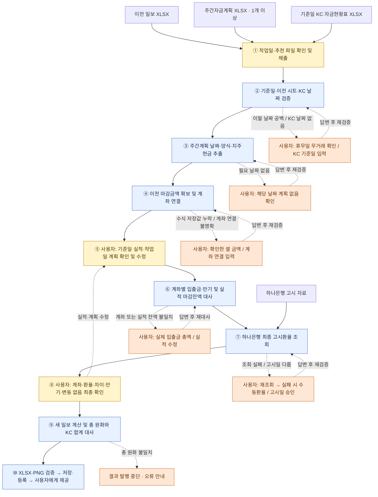

# 일일자금일보 작성 흐름

2026-10-16 구현 기준. 이전 일보의 마감금액을 이월하고, KC 계좌잔고와 담당자가 확인한 실제 거래를 대사한 뒤, 작업일 계획과 환율을 반영하여 새 일보를 만든다. LLM은 요청을 해당 도구로 연결하고, 계산과 검증은 코드가 수행한다.

업무 규칙·실행 계약의 기준 문서는 [Business tools and Daily Cash](../docs/BUSINESS_TOOLS.md#daily-cash), 질문과 처리 순서의 구현은 [dailyCash.ts](../electron/business/dailyCash.ts)이다.

## 어떤 자료를 참고하는가

**일보 기준일 = 작업일 − 1일(달력 기준)**이다. 예를 들어 작업일이 2026-10-15이면 10월 14일 실적·마감잔고와 10월 15일 계획을 작성한다. 이전 일보는 10월 14일보다 앞선 가장 최근 마감 시트를 사용한다.

| 참고 자료 | 읽는 내용 | 일보에 사용하는 방식 |
| --- | --- | --- |
| 이전 일일자금일보 XLSX 1개 | 기준일 이전 최신 `YYMMDD` 시트, H열 마감금액, 계좌·예금·만기 정보, O/P 사업부 보조표, 기존 서식 | 이전 H열 금액을 새 D열 전일금액으로 이월하고 계좌 연결 및 새 시트의 틀로 사용한다. |
| 주간자금계획 XLSX 1개 이상 | `세부계획(원화,외화)` 시트의 B열 실제 날짜, C/H열이 `지주현금`인 상세행. 입금은 D/F/G열의 적요·거래처·금액, 지급은 I/K/L열 | 기준일 계획은 **담당자가 확인할 실적 초안**, 작업일 계획은 다음 날 계획으로 사용한다. 합계행은 제외하며 주 경계에서는 두 주 파일이 필요할 수 있다. |
| 기준일 KC 자금현황표 XLSX 1개 | 계좌·통화·입출금, **O열 계좌잔고**, `환종별합계 KRW` | 계좌별 마감잔고 및 총 원화 대사의 기준. M열 장부잔액을 실제 계좌잔고 대신 쓰지 않는다. |
| 하나은행 기준일 최종 고시환율 | USD·JPY·CNY 매매기준율, 고시일·회차·고시시각·출처 | 외화 환산에 사용한다. JPY는 100엔당 고시를 1엔당 값으로 변환한다. 조회 실패 시 담당자가 확인한 환율을 수동 입력받는다. |
| 담당자 확인·수정값 | 실제 집행, 누락 거래, 계좌 연결, 입출금 총액, 예외 승인 | 원천자료만으로 확정할 수 없는 정보를 보완한다. 잔액 차이로 거래나 이자를 추정하지 않는다. |

## 전체 플로차트

파란색은 자동 처리, 노란색은 필수 사용자 입력·확인, 주황색은 조건부 피드백이다. 점선은 해당 조건에서만 발생하는 질문이며, 답변 후 해당 검증을 다시 수행한다. 단계 번호는 아래 표와 대응한다.

각 자동 단계에서도 날짜·양식·지원 범위 검증 실패 시 중단될 수 있다. 파일 교체가 필요한 경우의 처리 기준은 아래 표에 명시했다.

## 단계별 확인 사항과 사용자 피드백

여기서 피드백은 **시스템이 사용자에게 보여주는 질문·오류 안내**와 **사용자가 돌려주는 확인·수정값**을 함께 뜻한다.

| 단계 | 시스템이 확인·처리하는 것 | 사용자에게 보내는 피드백 / 사용자가 제출하는 것 |
| --- | --- | --- |
| ① 자료 선택 | 연결된 검색 폴더의 파일명으로 후보를 추천한다. 작업일 기본값은 서울 기준 오늘이다. | **필수:** 작업일과 이전 일보·주간계획·KC 파일을 확인하거나 교체한 뒤 제출한다. 추천은 내용 검증을 대신하지 않는다. |
| ② 날짜 검증 | 미래 작업일, 기준일 시트 중복, 이전 마감 시트 존재 여부, 이전 시트가 기준일보다 7일 넘게 오래됐는지, KC 파일명 날짜 일치를 확인한다. | **조건부:** 직전 날짜와 공백이 있으면 마지막 마감자료가 맞고 휴무일 거래가 없었는지 확인받는다. KC 파일명에 날짜가 없으면 기준일을 입력받는다. 날짜 불일치·너무 오래된 일보·중복 시트는 오류로 중단한다. |
| ③ 계획 추출 | 파일명이 아닌 셀 날짜로 기준일·작업일을 찾고, 양식 및 지주현금 상세행을 확인한다. 여러 파일의 동일 날짜 중복을 거부한다. | **조건부:** 필요한 날짜가 없으면 실제로 계획이 없는지 확인받는다. 잘못된 주차·중복 버전·잘못된 양식이면 올바른 파일로 새 작업이 필요하다. |
| ④ 이월·계좌 연결 | 이전 마감금액의 수식 저장값을 확보한다. 예금은 은행·통화·명시된 만기일·원금으로 연결하며, 사업부는 계좌코드+통화로 O/P 보조표에 연결한다. | **조건부:** 저장값 누락이 20개 이하면 확인한 셀 금액을 입력받고, 초과하면 Excel에서 재계산·저장한 원본으로 새 작업을 안내한다. 연결 불명확 시 `계좌코드:통화 → H/P 셀` JSON을 요청한다. 같은 조건의 예금 후보는 순서대로 연결되므로 최종 검토가 필요하다. |
| ⑤ 실적·계획 확인 | 기준일 계획과 작업일 계획을 각각 편집 표로 제시한다. KC에는 개별 거래 적요가 없으므로 계획을 실적으로 자동 확정하지 않는다. | **필수:** 실제 집행금액으로 수정하고 미집행은 0, 계획에 없던 거래는 행 추가로 입력한다. 작업일 계획도 함께 확인한다. 잘못된 금액·행 번호는 수정 요청한다. |
| ⑥ 잔액 대사 | 계좌별 `전일금액 + 실제 입금 − 실제 지급 = KC 계좌잔고`를 확인한다. 별도로 지주현금 실적의 마감잔액과 KC 원화 현금잔고를 대사한다. 만기 예금은 기존 원금 전액 감소로 처리한다. | **조건부:** 차이가 난 계좌와 금액을 보여주고 실제 계좌별 입출금 총액 또는 실적 수정을 요청한다. 만기인데 잔고가 남으면 만기 입금·연장을 확인하여 원천을 정정하도록 안내한다. 차이를 임의의 지급·이자·수취계좌로 메우지 않는다. |
| ⑦ 환율 확보 | 기준일 최종 고시를 조회하고 출처·응답 해시 등을 저장한다. 재실행 때 저장된 조회 결과를 재사용한다. | **조건부:** 첫 조회 실패 시 재조회 버튼, 재조회도 실패하면 담당자가 하나은행 화면에서 확인한 고시일·회차·USD·JPY(100엔)·CNY 입력을 요청한다. 적용 고시일이 기준일과 다르면 별도 승인받는다. 수동 입력 여부는 기록한다. |
| ⑧ 최종 확인 | 적용 계좌, 환율, 계획 대비 실적 차이, 만기, 원천자료 등을 묶어 확인 코드를 만든다. | **필수:** 계좌 연결·실적 차이·만기·환율을 검토하고, 원천 수식 재계산·저장 완료 및 미매핑 빈 계좌·기타 채권·적금·신탁에 변동이 없음을 확인한다. 확인 버튼은 해당 코드를 제출한다. 실적·계획을 수정하면 새 코드로 재확인한다. 이 승인은 향후 작업에 자동 적용되지 않는다. |
| ⑨ 일보 작성 | 기존 서식·병합을 복사하고 H→D 이월, 잔고·증감·환율 및 실적·계획을 채워 재계산한다. 왼쪽 표는 기준일 실적, 오른쪽 표는 작업일 계획이다. 총 원화를 KC의 KRW 합계와 대사한다. | **불일치 시:** 일보 합계·KC 합계·차이를 안내하고 결과 발행을 중단한다. 금액은 소수 원 단위를 유지하며 대사 허용 차이는 엄격히 1원 미만이다. |
| ⑩ 결과 제공 | 모든 업무 검사 통과, XLSX 재열기, PNG 형식 검증 후 원본 XLSX를 갱신하고 결과를 저장·DB 등록한다. | **완료 안내:** 날짜 시트가 추가된 XLSX와 PNG를 제공한다. 검증 실패 시 결과를 제공하지 않고 오류를 안내한다. 작업 중 원본이 변경되면 갱신을 중단한다. |

## 피드백 이후 재개와 결과물

추가 질문은 입력 카드로 전달되고, 사용자 답변 후 누적 입력값과 저장된 체크포인트를 가지고 **처음부터 다시 실행**한다. 플로차트의 되돌림 화살표는 논리적으로 재검증하는 지점을 뜻한다. 최초 실행이 수락되면 초기 입력·파일·해시·도구 버전이 고정되므로, 원천 파일 교체나 수정이 필요하면 새 작업을 시작해야 한다. 일반 오류는 기존 답변을 유지한 입력 카드로 돌아간다.

선택한 원본 XLSX에 기준일 `YYMMDD` 시트만 추가해 같은 경로에 갱신한다. 작업 중 원본 파일이 바뀌면 덮어쓰지 않고 새 작업을 안내한다. 대사 결과, 환율, 적용 계좌, 거래 및 원천자료 정보는 앱의 작업 기록에 남긴다. PNG는 O/P 사업부 표까지 포함하는 자체 렌더링이며 Excel 화면 캡처가 아니다.

기타 채권·적금·신탁의 변경, 지원되지 않는 계좌·예금·템플릿 변경은 현재 v1에서 자동 해결하지 않는다. 실제 날짜가 일치하는 원천자료 전체에 대한 정답 비교 검증은 아직 남아 있다. 상세 제약과 검증 상태는 [검증 및 데모](../docs/BUSINESS_TOOLS.md#validation-and-demo)를 참고한다.

## 구현 근거

| 확인 대상 | 참고 코드·문서 |
| --- | --- |
| 업무 규칙·입출력 계약 | [BUSINESS_TOOLS.md](../docs/BUSINESS_TOOLS.md#daily-cash) |
| 실행 순서·질문·최종 승인 | [dailyCash.ts](../electron/business/dailyCash.ts) |
| KC 해석·계획 대비 차이 | [cashStatus.ts](../electron/business/dailyCash/cashStatus.ts) |
| 주간계획 상세행 추출 | [weekly.ts](../electron/business/dailyCash/weekly.ts) |
| 계좌 연결·만기·이월·일보 생성 | [report.ts](../electron/business/dailyCash/report.ts) |
| 환율 조회 | [hana.ts](../electron/business/dailyCash/hana.ts) |
| 입력 재개·파일 검증·결과 저장 | [flow.ts](../electron/business/flow.ts) |
